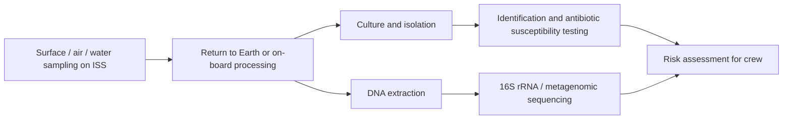

# 01 · The ISS Microbiome

## Why it matters
The International Space Station (ISS) is a closed, human-occupied habitat. Microbes arrive on astronauts, cargo and equipment and live on surfaces, in air and in water systems. Monitoring them protects crew health and equipment.

## Key points
- Most ISS surface microbes are human-associated (skin and oral flora), e.g. *Staphylococcus*, *Corynebacterium*, *Bacillus*.
- Environmental fungi and bacteria are also found on surfaces.
- Some isolates, such as *Enterobacter bugandensis*, show multidrug resistance and have been compared genomically with clinical strains.
- Monitoring uses culture methods, 16S rRNA sequencing and metagenomics.

## Sampling workflow

## Questions to explore
- How does the ISS microbiome compare with Earth hospital environments?
- Which monitoring methods are most useful for long missions?

*Add your own notes and figures here. Check facts against `references/references.md`.*
