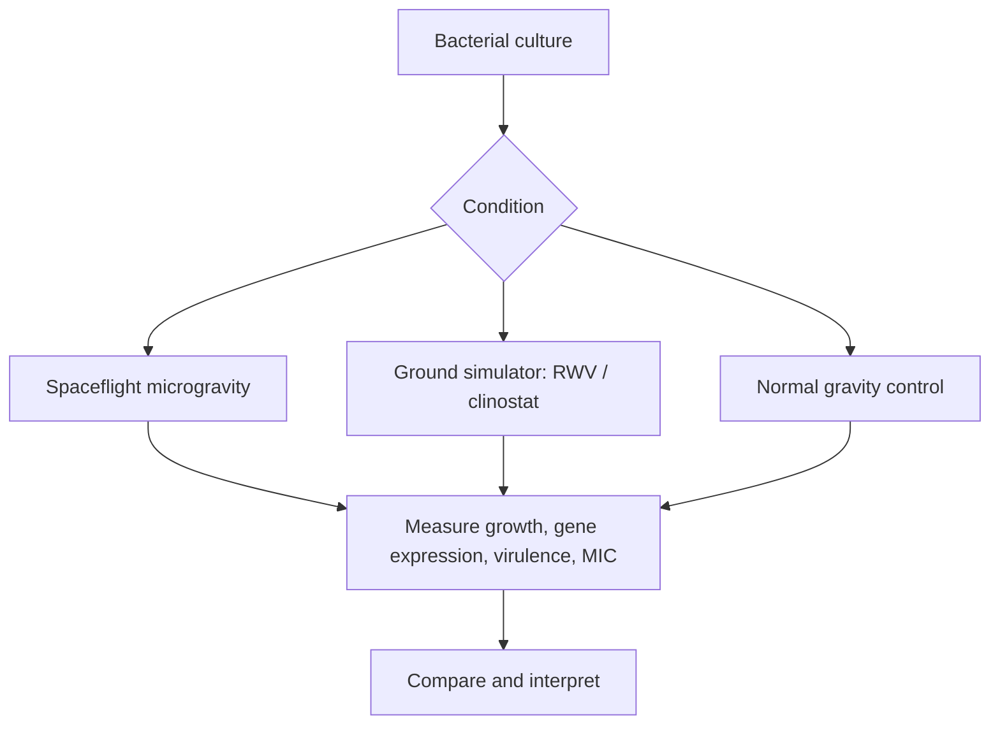

# 02 · Microgravity and Bacteria

## Why it matters
In microgravity, fluids do not convect the way they do on Earth. Cells experience a low-shear, diffusion-limited environment, which can change gene expression and behaviour.

## Key points
- Reported effects (organism- and condition-dependent): altered growth rate, changed stress responses, altered biofilm formation and, in some studies, changed virulence.
- *Salmonella* Typhimurium grown on spaceflight showed increased virulence in a mouse model (Wilson et al., 2007). It is a classic, widely cited example.
- Ground simulators (Rotating Wall Vessel, clinostat) mimic **low-shear modelled microgravity** and are used because spaceflight is rare and costly.
- Results vary between species, strains and media, so avoid generalising.

## Experimental logic

## Questions to explore
- Which bacterial genes respond most consistently to microgravity?
- How well do ground simulators predict true spaceflight results?
