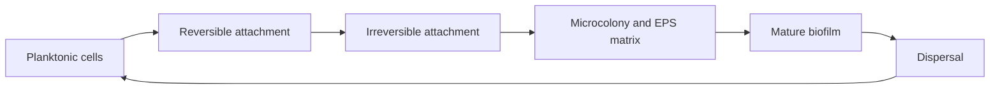

# 03 · Biofilms and Antimicrobial Resistance (AMR)

## Why it matters
Biofilms are surface-attached microbial communities in a self-made matrix. They resist cleaning and antibiotics, and they can foul water recovery systems and equipment on spacecraft. AMR is a major clinical problem on Earth, so space findings can inform both.

## Key points
- Biofilm stages: attachment → microcolony → maturation → dispersal.
- Spaceflight studies have reported altered biofilm architecture and biomass for some species, for example *Pseudomonas aeruginosa* (Kim et al., 2013).
- Some experiments report changed antibiotic susceptibility or stress tolerance under spaceflight or simulated microgravity; findings are mixed.
- Quorum sensing and horizontal gene transfer are linked to biofilm behaviour and AMR spread.

## Biofilm life cycle

## Link to clinical research
Understanding how environment changes biofilm and resistance may help design better surfaces, disinfectants and antibiotic strategies for hospitals as well as spacecraft.
