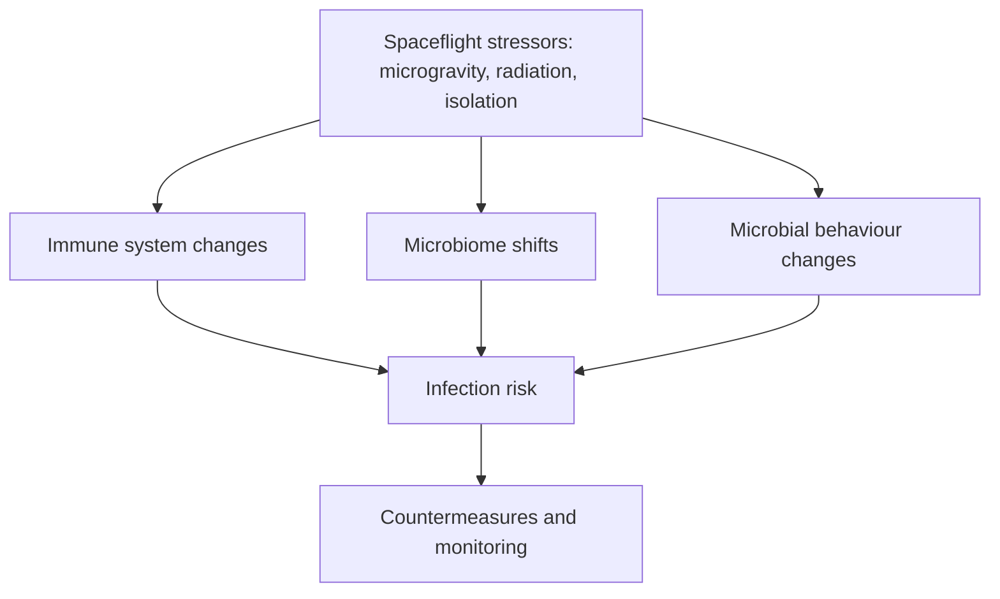

# 04 · Astronaut Immunity and Health

## Why it matters
Spaceflight stressors (microgravity, radiation, isolation, altered circadian rhythm) can influence the immune system and the human microbiome. This matters for infection risk on long missions.

## Key points
- Reported immune changes include altered cytokine profiles and reactivation of latent viruses (e.g. herpesviruses such as EBV, VZV) in some astronauts.
- Spaceflight can change gut and skin microbiome composition; the NASA Twins Study explored multi-omic changes during a year-long mission (Garrett-Bakelman et al., 2019).
- Countermeasures under study include exercise, nutrition, probiotics and monitoring.
- Many findings come from small cohorts, so interpret carefully.

## Host–microbe–environment model

## Questions to explore
- Which biomarkers best predict infection risk in astronauts?
- Can ground clinical immunology models help, e.g. bed-rest studies?
