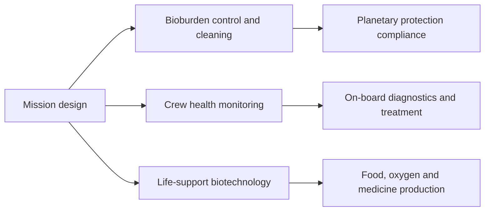

# 05 · Planetary Protection and the Future

## Why it matters
Missions to the Moon and Mars must avoid **forward contamination** (taking Earth microbes to other worlds) and **back contamination** (bringing anything back to Earth). Long missions also need reliable life-support, medicine and diagnostics.

## Key points
- Planetary protection policy is coordinated internationally (COSPAR), with spacecraft cleanliness and bioburden monitoring.
- Spacecraft cleanrooms harbour hardy, stress-tolerant microbes; studying them informs sterilisation methods.
- Space biotechnology topics: bioregenerative life support, microbial production of nutrients and medicines (in-situ resource use), on-board sequencing and point-of-care diagnostics.
- Portable sequencers have been used on the ISS, showing that real-time microbial identification in orbit is feasible.

## Mission-planning view

## Ideas for your own extension
- Compare planetary-protection rules for Moon and Mars.
- Review microbes proposed for Mars biomanufacturing.
