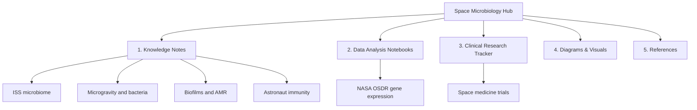

# 🚀🦠Space Microbiology Hub

An interactive knowledge project on **microbes in space**: how microgravity and the spaceflight environment change bacterial growth, biofilms, virulence and antibiotic resistance, and what this means for **astronaut health, medical biotechnology and clinical research**.

> Author: **Vanshika Sharma**, B.Sc. (Hons.) with Research in Biotechnology, Banasthali Vidyapith, Rajasthan
> Interests: Microbiology , Medical Biotechnology , Clinical Research , Space Science & Medicine

---

## 🎯 Aims

1. Build a clear, referenced knowledge base on space microbiology.
2. Analyse **public** datasets (NASA OSDR, ClinicalTrials.gov) using reproducible notebooks.
3. Connect space findings to **earth-based clinical problems** such as antimicrobial resistance (AMR) and infection control.
4. Present everything as an interactive website using GitHub Pages.

## 🗺️ Project map



## 📁 Repository structure

```
space-microbiology-hub/
├── README.md
├── LICENSE
├── .gitignore
├── index.md                  # GitHub Pages home page
├── _config.yml               # GitHub Pages theme
├── notes/
│   ├── 01-iss-microbiome.md
│   ├── 02-microgravity-and-bacteria.md
│   ├── 03-biofilms-and-amr.md
│   ├── 04-astronaut-immunity-and-health.md
│   └── 05-planetary-protection-and-future.md
├── notebooks/
│   └── 01_osdr_exploration.ipynb
├── clinical-tracker/
│   └── README.md
├── diagrams/
│   └── diagrams.md           # Mermaid flowcharts
├── references/
│   └── references.md
└── docs/
    └── project-plan.md
```

## 🔬 Modules

| Module | What it covers | Status |
|---|---|---|
| Notes | Concept notes with flowcharts | 🟡 Starter drafted |
| Notebooks | Python analysis of public NASA OSDR data | 🟡 Template ready |
| Clinical tracker | Space-medicine trials from ClinicalTrials.gov | ⚪ To do |
| References | Curated, annotated paper list | 🟡 Starter list |

## 🧪 How to run the notebooks

```bash
git clone https://github.com/vanshikasharma9406-vs/space-microbiology-hub.git
cd space-microbiology-hub
pip install pandas matplotlib jupyter
jupyter notebook
```

Or open the notebook directly in Google Colab.

## 🌐 Interactive site

Enable it in **Settings → Pages → Deploy from branch → main / root**. The site will appear at
`https://vanshikasharma9406-vs.github.io/space-microbiology-hub/`

## 🤝 Contributing

Suggestions and corrections are welcome. Open an **Issue** or a **Pull Request**.

## ⚠️ Disclaimer

This is an educational student project. It is not medical advice. Please verify every claim against the original papers listed in `references/`.

## 📄 License

MIT License. See `LICENSE`.
