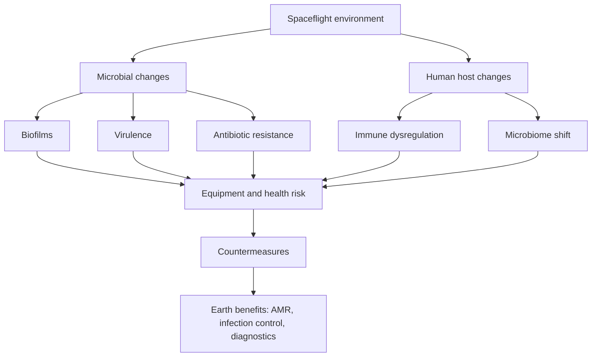
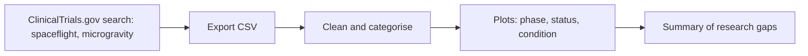

# Diagrams

All diagrams use [Mermaid](https://mermaid.js.org/), which GitHub renders automatically.

## 1. Big picture: from space microbes to Earth medicine

## 2. Research workflow used in this project

## 3. Clinical-trial tracker workflow

